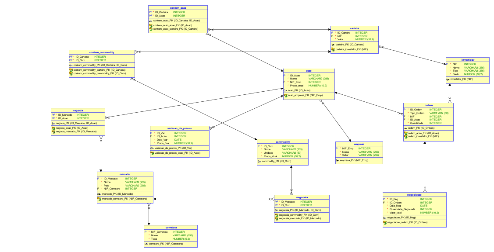

# Base de Dados - Bolsa de Valores (Stock Exchange Database)

Projeto académico de modelação de bases de dados relacionais desenvolvido em grupo de 3 elementos para um sistema de Bolsa de Valores, utilizando **Oracle Database**.

---
## Visão Geral do Projeto
Este repositório contém o design da base de dados relacional e os scripts **DDL** para uma plataforma de mercado de ações. O sistema modela as interações entre investidores, carteiras de ações, empresas, *commodities*, mercados financeiros e corretoras, incluindo a execução de ordens e variações de preços.

---

## Tecnologias e Ferramentas
- **Database Management System (DBMS):** Oracle Database 21c
- **Ferramenta de Modelação:** Oracle SQL Developer Data Modeler
- **Linguagem:** SQL (DDL)

---

## Arquitetura e Esquemas da Base de Dados
1. **Modelo Conceptual**
   
3. **Modelo Relacional**
   
---

## Estrutura do Repositório
- **`bolsa_de_valores.DDL`**: Script SQL DDL para gerar tabelas, *primary keys* e restrições de *foreign keys* (*constraints*).
- **`conceptual-model.png`**: Diagrama *Entity-Relationship* (Modelo Conceptual).
- **`relational-model.png`**: Diagrama do Modelo Relacional.
- **`bolsa_de_valores.dmd`**: Ficheiro de projeto do Oracle SQL Developer Data Modeler.

---

## Entidades Principais
O esquema da base de dados é composto por 14 tabelas principais, incluindo:
- **`investidor`** & **`carteira`**
- **`acao`** & **`empresa`**
- **`commodity`**
- **`mercado`** & **`corretora`**
- **`ordem`** & **`negociacao`**

---

## Conclusões e Aprendizagens
Desenvolvido no âmbito da unidade curricular de **Bases de Dados**, este projeto permitiu ligar os conceitos teóricos de bases de dados ao design prático de sistemas. Através da sua execução, adquirimos experiência prática em:
- **Modelação Relacional:** Traduzir regras de negócio e requisitos reais num modelo *Entity-Relationship* estruturado e num esquema relacional.
- **Arquitetura De Base de Dados:** Definir relações entre tabelas, *primary/foreign keys* e restrições de integridade referencial (*referential integrity constraints*, como *cascade deletions*).
- **Ferramentas:** Utilizar o Oracle SQL Developer Data Modeler e gerar scripts SQL DDL automatizados.
- **Trabalho em Equipa:** Trabalhar em equipa (grupo de 3) para planear, desenhar e estruturar uma camada de dados (*data layer*) de raiz.
