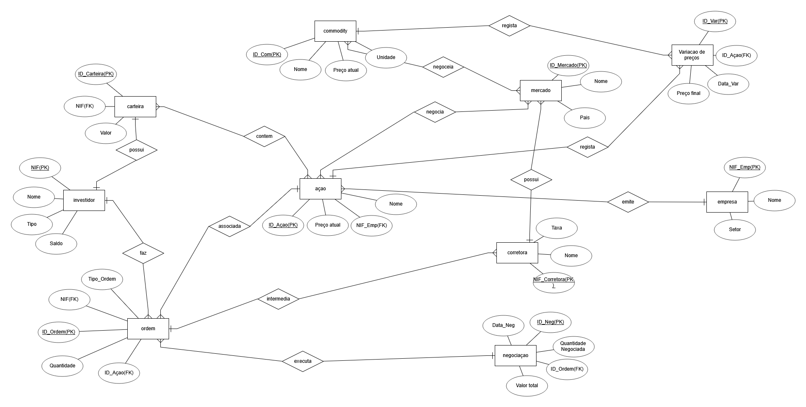

# Stock Exchange Database (Bolsa de Valores)

Academic relational database modeling project developed in a group of 3 for a Stock Exchange system, utilizing Oracle database.

## Project Overview
This repository contains the relational database design and DDL scripts for a stock market platform. The system models interactions between investors, stock portfolios, companies, commodities, financial markets, and brokerages, including order execution and price variations.

## Technologies & Tools
* **Database Management System:** Oracle Database 21c
* **Modeling Tool:** Oracle SQL Developer Data Modeler
* **Language:** SQL (DDL)

## Database Architecture & Schemas

### 1. Conceptual Model (Entity-Relationship)

### 2. Relational Model

## Repository Structure
* `bolsa_de_valores.DDL` - SQL DDL script to generate tables, primary keys, and foreign key constraints.
* `conceptual-model.png` - Entity-Relationship diagram.
* `relational-model.png` - Relational model diagram.
* `bolsa_de_valores.dmd` - Oracle SQL Developer Data Modeler project file.

## Main Entities
The database schema consists of 14 primary tables, including:
* **`investidor`** (Investors) & **`carteira`** (Portfolios)
* **`acao`** (Stocks) & **`empresa`** (Companies)
* **`commodity`** (Commodities)
* **`mercado`** (Markets) & **`corretora`** (Brokerages)
* **`ordem`** (Orders) & **`negociacao`** (Trades)

## Conclusions & Learnings
Developed as part of our academic coursework in Databases, this project allowed us to bridge theoretical database concepts with practical system design. Through its execution, we gained hands-on experience in:
* **Relational Modeling:** Translating real-world business rules and requirements into a structured Entity-Relationship model and a relational schema.
* **Database Architecture:** Defining table relationships, primary/foreign keys, and referential integrity constraints (such as cascade deletions).
* **Tooling:** Utilizing Oracle SQL Developer Data Modeler and generating automated SQL DDL scripts.
* **Team Collaboration:** Working collaboratively in a group of 3 to plan, design, and structure a data layer from scratch.
